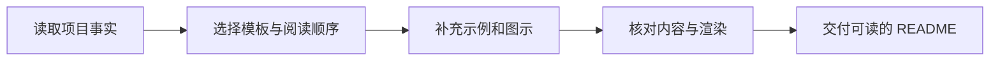

<div align="center">

# README Polish

**让项目首页一眼看懂：做什么、怎么用、结果是什么。**

[](skills/readme-polish/SKILL.md)
[](LICENSE)

[快速开始](#快速开始) · [优化哪些内容](#优化哪些内容) · [开源来源](#开源来源)

</div>

这是一个独立的全局 Codex Skill。它读取项目实际内容，整理 README 的阅读顺序，
补充有用的示例和图示，并检查命令、链接、徽章及渲染结果。



## 优化哪些内容

| 常见问题 | 优化后的阅读体验 |
|---|---|
| 打开就看到大段技术细节 | 首屏说明用途、受众和一个直观示例 |
| 功能堆在一起，看不出重点 | 按用户任务整理，必要时配行为对照表 |
| 想试用却找不到命令 | 最短可验证的快速开始，深入说明单独链接 |
| 徽章很好看，但状态不真实 | 只使用能核实的平台、许可证或状态徽章 |
| Markdown 源码正常，显示有问题 | 检查图片、链接、锚点和可用的渲染预览 |

具体布局会随 CLI、库、GUI 或数据集调整；不强制套用全部章节。

## 快速开始

### 安装

把本仓库的 [`skills/readme-polish`](skills/readme-polish) 文件夹安装到你当前 Codex
使用的个人技能目录。此环境使用 `~/.codex/skills/`：

```powershell
git clone https://github.com/Elio-SiChien/readme-polish-skill.git
Copy-Item -LiteralPath '.\readme-polish-skill\skills\readme-polish' -Destination "$env:USERPROFILE\.codex\skills" -Recurse
```

示例适用于目标目录已存在且未安装同名技能的情况；已有同名版本时先检查再更新。
其他 Codex 环境应使用其实际识别的个人技能目录。

### 调用

进入需要优化的项目，直接告诉 Codex：

> 优化这个项目的 README，让首页更直观，突出示例和快速开始。

或显式调用：

> 使用 `$readme-polish` 优化这个项目的 README，并检查命令、链接和渲染效果。

技能允许按请求内容自动匹配，也支持显式调用。默认修改文档及必要的配套图片；
发布到 GitHub 按当前会话的授权执行。只要求调查时，只做调查。

## 开源来源

| 项目 | 如何使用 |
|---|---|
| [Best-README-Template](https://github.com/othneildrew/Best-README-Template) | 借鉴标题、导航和快速开始的结构；配套模板使用原创措辞 |
| [Shields](https://github.com/badges/shields) | 本页使用其徽章服务，技能要求徽章表达真实事实 |
| [awesome-readme](https://github.com/matiassingers/awesome-readme) | 挑选相近项目，参考演示和信息层级 |
| [readme.so](https://github.com/octokatherine/readme.so)、[readme-ai](https://github.com/eli64s/readme-ai) | 可选编辑与草稿工具，不作为本技能的运行依赖 |

复用关系和边界见 [来源说明](skills/readme-polish/references/sources.md)。
本项目提供的是 Codex 工作流，不是新的 README 生成引擎。

## 包含什么

- [技能指令](skills/readme-polish/SKILL.md)：何时调用、如何改写及交付。
- [可改写模板](skills/readme-polish/assets/README.template.md)：按项目裁剪，移除替换字段后使用。
- [验证清单](skills/readme-polish/references/quality-check.md)：事实、命令、链接、渲染及发布检查。
- [界面与自动匹配配置](skills/readme-polish/agents/openai.yaml)。

不需要额外 API Key、Node 服务或另一个模型。实际项目的截图、命令验证和渲染
取决于当前环境；未完成的检查必须如实报告。

## 许可证

本项目原创内容使用 [MIT](LICENSE) 许可证。上游项目保留各自的许可证；
参考案例的图片和品牌素材不自动获得再分发许可。
